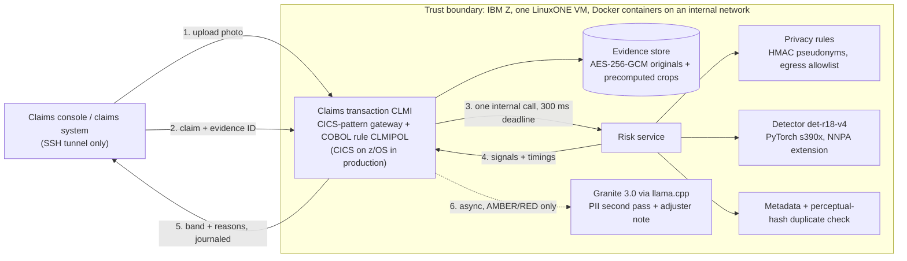

# Aegis: AI-edited claim photo screening on IBM Z

**IBM Z Datathon 2026 · Theme 1, Real-Time AI for Critical Decisions**

Every photo attached to a motor-insurance claim is screened for AI generation or AI editing *inside the claims transaction*, in real time, with every model running on IBM LinuxONE so customer data never leaves it. Honest claims are fast-tracked. Suspicious ones go to a person, with reasons. Nothing is ever rejected automatically.

Why it matters: UK insurers detected £1.34bn of fraud across 93,900 claims in 2025, 55% of them motor ([ABI via Insurance Business](https://www.insurancebusinessmag.com/uk/news/claims/fewer-fraud-cases-fatter-claims-as-average-scam-hits-14300-592527.aspx)). Insurers report rising use of AI-generated images and the same damage photo re-submitted with a different number plate ([Admiral](https://www.admiral.com/press-office/the-white-lie-effect-1-in-8-admit-exaggerating-insurance-claims-as-untruths-and-ai)). Only 7% of anti-fraud professionals feel more than moderately prepared for it ([ACFE/SAS](https://www.sas.com/en_us/news/press-releases/2026/may/synthetic-images-ai-insurance-fraud.html)).

## What happens to a claim



1. **Upload** (`POST /evidence`): decode, EXIF orientation, three 224 px crops, SHA-256, perceptual hash, metadata flags, encrypt the original. Done once so the decision path only runs inference.
2. **Claim** (`POST /claims`, transaction `CLMI`): validate, idempotency check, pseudonymise personal data, call the risk service with a hard 300 ms deadline.
3. **Risk service**, in parallel: privacy rules on the description, detector on the stored crops, metadata flags, perceptual-hash lookup against other claims' photos.
4. **Decision rule `CLMIPOL.cbl`** (GnuCOBOL on LinuxONE): RED if score ≥ τ_red or the photo was already used on another claim; AMBER if τ_amber ≤ score < τ_red, an editing tool is named in metadata, the photo is low-resolution, or the risk service failed; GREEN otherwise. Claim, decision, egress payload and journal commit in one SQLite transaction.
5. **After the decision** (AMBER/RED only): Granite runs a PII second pass and writes a three-bullet adjuster note. It can never change the band.

Details: [`txn/README.md`](txn/README.md) (gateway, COBOL rule, privacy, production CICS design), [`risk_service/README.md`](risk_service/README.md), [`llm/README.md`](llm/README.md), [`ui/README.md`](ui/README.md), [`train/HANDOFF.md`](train/HANDOFF.md).

## Results

Detector `det-r18-v4`, ResNet-18 fine-tuned on Modal, evaluated on a held-out test split ([`eval/results.md`](eval/results.md), [`eval/model_card.md`](eval/model_card.md), [`data/dataset_card.md`](data/dataset_card.md)):

| Test set | AUROC | TPR at 1% FPR | Real-photo FPR at τ_red |
|---|---|---|---|
| In-distribution (regenerated, inflated, SDXL) | 0.936 | 0.674 | 1.2% |
| **FLUX.1-schnell, never trained on** | 0.944 | 0.502 | 1.2% |
| Real photo vs its own regenerated copy | 0.985 | 0.746 | 1.2% |
| Damage inflation (small inpainted edits) | 0.622 | 0.041 | 1.2% |
| **Real damage photos only** | — | — | **1.2%** (AMBER 5.0%) |
| JPEG quality 50 | 0.908 | 0.402 | 2.3% |
| Half-size photos | 0.807 | 0.183 | 16.8% → low-resolution rule |

Shortcut checks: damage share differs by 0.5 points between classes; file size, dimensions and colour alone give AUROC 0.50 to 0.55. RED rate among real photos stays within 0.4% to 2.8% across quality, size, source and damage subgroups. Charts: `eval/charts/`.

LinuxONE: stock ResNet-18 on three crops, 100 runs, p50/p95 **104.6/109.9 ms on CPU** and **18.6/20.4 ms with the NNPA extension**, a 5.6× median speed-up ([`eval/stock_resnet18.md`](eval/stock_resnet18.md)). Full claim-path latency and the 1/4/8-client sweep are produced by `linuxone/benchmark_gateway.py` into `eval/latency.md` once the trained model is installed on the VM ([`linuxone/RUNBOOK.md`](linuxone/RUNBOOK.md)).

## Run it

**On the LinuxONE VM** (Ubuntu 22.04, s390x, Docker):

```bash
git clone <this repo> && cd Aegis
bash linuxone/start_services.sh --with-gateway            # risk service + gateway with native GnuCOBOL
python3 linuxone/install_model.py --run det-r18-v4 --weights models/det-r18-v4/best.pt \
    --temperature models/det-r18-v4/temperature.json --export models/det-r18-v4/export.json \
    --thresholds eval/thresholds_t-0.json                  # A's trained detector (committed under models/) + thresholds
bash linuxone/start_services.sh --with-gateway --with-granite   # after python3 linuxone/provision_granite.py --download
bash linuxone/service_status.sh
```

From your laptop: `ssh -i key.pem -L 8080:localhost:8080 linux1@<IP>` and open http://localhost:8080. No ports are opened on the VM. `python demo/feed_claims.py --gateway http://localhost:8080 --photos demo_assets` stands in for the insurer's claims system and pushes the demo claims through the real pipeline.

**Locally, without the VM** (Python 3.11; the COBOL tests run if `cobc` is installed):

```bash
uv venv --python 3.11 .venv && uv pip install --python .venv/bin/python -r txn/requirements.txt -r llm/requirements.txt -r risk_service/requirements.txt pytest
.venv/bin/python -m pytest -q                               # gateway, policy, privacy, risk service, Granite contract, platform tools
.venv/bin/uvicorn txn.stub_risk:app --port 9000 &            # labelled development stub for the risk service
.venv/bin/uvicorn txn.gateway.app:app --port 8080            # console at http://localhost:8080, with ?demo=1 for offline demo data
```

Training and evaluation run on Modal: `train/train_modal.py`, `train/clip_probe_modal.py`, `train/eval_modal.py`, `train/export_onnx.py`; data pipeline in `data/`.

## What is real and what is simulated

| Piece | Status |
|---|---|
| Dataset generation and training | Real, on Modal GPUs (Stable Diffusion 2 inpainting, SDXL, FLUX.1-schnell for the hold-out) |
| Detector evaluation and thresholds | Real. `t-0` fitted on Modal FP32 scores; `t-1` is fitted on LinuxONE scores after the parity check (`linuxone/parity_logits.py`, `train/fit_thresholds_linuxone.py`) |
| Detector inference | Real, on LinuxONE, PyTorch for s390x with the NNPA extension. **zDLC compilation was not achieved** (registry authentication); the retry path is in `zdlc/` |
| Privacy rules, pseudonymisation, egress allowlist and log, encrypted evidence store | Real, on LinuxONE |
| Decision rule | **Real COBOL**, compiled with GnuCOBOL 3.2 inside the gateway container on LinuxONE; 25 truth-table cases match the Python twin |
| CICS | **Emulated** by the FastAPI gateway (idempotency key, one-transaction syncpoint, append-only journal). Production design in `txn/README.md` |
| On-prem LLM | Real: Granite 3.0 1B big-endian GGUF through llama.cpp on LinuxONE, provisioned by `linuxone/provision_granite.py`. No external LLM is configured |
| Claims console | Real UI reading the gateway; falls back to labelled demo data offline. Case actions are browser-local |
| Customer data | Fictional personas only |

Responsible-AI statement: [`eval/rai.md`](eval/rai.md). Evidence for judges: `eval/*.json`, `eval/*.md`, `evidence/` (collected by `linuxone/collect_evidence.sh`).

## Repository layout

```
data/           Commons fetch, real-photo prep, Modal generation, dataset build, manifests, dataset card
train/          training, CLIP probe, evaluation, ONNX export, LinuxONE threshold fitting, A→B handoff
eval/           results, model card, RAI statement, thresholds, LinuxONE benchmarks and smoke reports, charts
risk_service/   upload precompute, encrypted evidence store, detector, duplicate check, heatmap, privacy adapter
txn/            CLMI gateway (FastAPI + SQLite journal), CLMIPOL.cbl, Python twin, development stub
privacy/        regex + gazetteer detection, HMAC pseudonyms, egress allowlist (shared by gateway and risk service)
llm/            Granite service, prompts, pinned model source, real-model smoke
ui/             claims-integrity console (served by the gateway), demo data, evidence manifest
demo/           claims-system stand-in and demo photo fetcher
linuxone/       VM launcher, status, benchmarks, smokes, model installer, parity scorer, evidence collector, runbook
zdlc/           IBM Z Deep Learning Compiler scripts (not yet run)
plan.md         the team plan this repository implements
```

## Team

- **A**: data, generation, training, evaluation, thresholds, dataset and model cards
- **B**: LinuxONE platform, risk service, Granite runtime, benchmarks, evidence
- **C**: CLMI gateway, COBOL decision rule, privacy, fail-safe, Granite prompts, RAI statement
- **D**: console UI, demo assets, story, video, submission

## Open-source software, models, data and resources used

Software: [PyTorch](https://pytorch.org/) and [torchvision](https://github.com/pytorch/vision) (ImageNet ResNet-18 weights, BSD-3), [IBM Z Accelerated for PyTorch / torch_nnpa](https://github.com/IBM/ibmz-accelerated-for-pytorch), [ONNX](https://onnx.ai/) and [IBM Z Deep Learning Compiler](https://github.com/IBM/zDLC), [Hugging Face diffusers](https://github.com/huggingface/diffusers), [open_clip / CLIP](https://github.com/mlfoundations/open_clip), [scikit-learn](https://scikit-learn.org/), [FastAPI](https://fastapi.tiangolo.com/), [Uvicorn](https://www.uvicorn.org/), [httpx](https://www.python-httpx.org/), [Pillow](https://python-pillow.org/), [NumPy](https://numpy.org/), [cryptography](https://cryptography.io/), [GnuCOBOL](https://gnucobol.sourceforge.io/), [llama.cpp](https://github.com/ggml-org/llama.cpp) and [llama-cpp-python](https://github.com/abetlen/llama-cpp-python), [Modal](https://modal.com/), [SQLite](https://sqlite.org/), [Docker](https://www.docker.com/), [matplotlib](https://matplotlib.org/).

Models: [stabilityai/stable-diffusion-2-inpainting](https://huggingface.co/stabilityai/stable-diffusion-2-inpainting), [stabilityai/stable-diffusion-xl-base-1.0](https://huggingface.co/stabilityai/stable-diffusion-xl-base-1.0), [black-forest-labs/FLUX.1-schnell](https://huggingface.co/black-forest-labs/FLUX.1-schnell) (test only), CLIP ViT-B/16 and ViT-L/14, [ibm-granite/granite-3.0-1b-a400m-instruct](https://huggingface.co/ibm-granite/granite-3.0-1b-a400m-instruct) as the big-endian GGUF [taronaeo/Granite-3.0-1B-A400M-Instruct-BE-GGUF](https://huggingface.co/taronaeo/Granite-3.0-1B-A400M-Instruct-BE-GGUF) (Apache-2.0, pinned in `llm/model-source.json`).

Data: [CarDD](https://cardd-ustc.github.io) (non-commercial research licence, used for training and the demo, not redistributed), [Wikimedia Commons](https://commons.wikimedia.org/) photos uploaded before 2022 under CC0, public domain, CC BY or CC BY-SA, with per-file attribution in `data/commons_manifest.csv` and `ui/evidence/manifest.json`. Images are never committed; only manifests.

Method and event resources: [B-Free (CVPR 2025)](https://arxiv.org/abs/2412.17671) for self-conditioned fakes, [UnivFD](https://arxiv.org/abs/2302.10174) for the CLIP probe, the [LinuxONE Community Cloud guides](https://github.com/linuxone-community-cloud/technical-resources), the event's [Jupyter Lab ML image and labs](https://github.com/linuxone-community-cloud/jupyter-lab-ml), [llama.cpp s390x build notes](https://github.com/ggml-org/llama.cpp/blob/master/docs/build-s390x.md). AI coding assistants were used for parts of the code, as the event allows; each team member owns and can explain their part.
