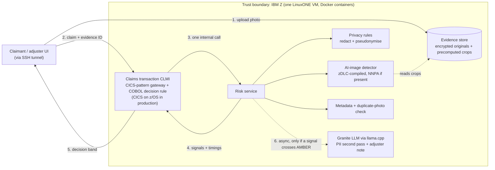

# Final plan: AI-edited claim photo screening on IBM Z

**Event:** IBM Z Datathon 2026 · **Theme:** 1, Real-Time AI for Critical Decisions · **Team:** A, B, C, D
**Hard deadline:** the EMEA hacking window closes **10:00 Sun 18 Oct (UK)**. Late or incomplete submissions can be disqualified. **Submit by 09:00.**
**Submission title:** `[<Team Name>_IBM Z Datathon 2026 Project]`

> **Pitch:** every photo attached to a motor insurance claim is screened for AI generation or AI editing inside the claims transaction, in real time, with every model running on IBM Z so customer data never leaves it. Honest claims are fast-tracked; suspicious ones go to a person, with reasons.

---

## 1. Decisions (locked)

| Topic | Decision | Why |
|---|---|---|
| Theme | **Theme 1: Real-Time AI for Critical Decisions** | "Insurance Risk" is Theme 1's own example idea; latency is its core; main prizes are per region and hub, not per theme |
| Domain | **Motor insurance** (car-damage photos) | 55% of UK detected fraud cases in 2025; freely licensed real photos exist; Admiral's number-plate example |
| Media | **Images only** | Video is roadmap |
| CICS | **Emulated on LinuxONE.** Nobody on the team has z/OS access and the event only provides LinuxONE. The decision rule is real COBOL, run with GnuCOBOL on LinuxONE. The video says plainly that CICS is emulated. | Hunting for z/OS access would cost hours with no guarantee |
| NNPA (Telum AI accelerator) | **Unknown. B checks by 14:30.** | Decides whether we say "runs on the Telum AI accelerator" or "runs on the LinuxONE CPU" |
| Training | **Modal GPUs** | LinuxONE does inference, final evaluation and thresholds |
| LLM | **IBM Granite on LinuxONE** via llama.cpp, the Lab 2 stack. Claude only as a labelled fallback. | All AI stays inside IBM Z |
| Demo access | **SSH tunnel, no public ports** | Nothing but SSH is exposed |
| AI-written code | **Allowed by the event** | Use it, but each person must understand and be able to explain their part |

## 2. Timeline and gates (UK time, Sat 17 → Sun 18 Oct)

| Time | Phase |
|---|---|
| 13:30–14:30 | Labs + setup |
| 14:30–17:30 | De-risk: real photos in, generation launched, stock model on LinuxONE, gateway skeleton |
| 17:30–21:30 | v1: dataset, training, risk service, first end-to-end claim |
| 21:30–03:00 | v2, thresholds, benchmarks, Granite, polish. **B and D sleep 23:30–03:00** |
| 03:00–06:30 | Evidence, README, slides. **A and C sleep 03:00–06:30** |
| 06:30–09:00 | Record, edit, submit |

| Gate | Time | Must be true | If not |
|---|---|---|---|
| G1 | 14:30 | Both labs done; VM reachable; NNPA yes/no known; Modal works; repo exists | Carry on, and cut scope early (§13) |
| G2 | 17:30 | Stock ResNet-18 compiled and timed on LinuxONE; all generation jobs launched; gateway skeleton runs | Detector fallback: PyTorch CPU in the Jupyter image. If that also fails by 19:00: Modal endpoint, labelled |
| G3 | 19:00 | Dataset built; v1 training running | Train on whatever exists; don't wait for stragglers |
| G4 | 21:30 | One claim end to end: UI → gateway → risk service → policy → band | Everyone helps until it works; SHOULD items wait |
| G5 | 03:00 | Feature freeze | Only fixes, evidence, README and video after this |
| G6 | 08:30 | Video final, ≤ 2:50 | Submit what exists at 09:00 |

---

## 3. Who does what

### Person A: data and model (Modal)

**Owns:** real photos, generated fakes, dataset, training, evaluation, thresholds, dataset and model cards. Details in §7.

**13:30–14:30**
- [ ] Lab 1 (*Predictive AI Hybrid AI scenarios, multi-model*) with D. Screenshot completion. Links: Hack2Skill platform or Discord #announcements.
- [ ] Request the Humans in the Loop "Car Parts and Car Damages" dataset (form on their site).
- [ ] Send the CarDD licence form (cardd-ustc.github.io). Use CarDD only if it's approved in time.
- [ ] Modal: `pip install modal` → `modal setup` → `modal volume create claimshield-data` → store a Hugging Face token as a Modal secret. Accept the terms on Hugging Face for every model in §7.3.

**14:30–17:30**
- [ ] Upload the Humans in the Loop files to the Modal volume.
- [ ] Run the Wikimedia Commons fetch (§7.2). Target ≥ 1,000 photos. Spot-check 100 by eye; remove toys, drawings, renders, and anything showing injured people.
- [ ] Make real masters: long side 768 px (both sides multiples of 8), PNG, plus a manifest with id, source, licence, author, damage yes/no.
- [ ] Launch all four generation jobs (§7.3), fanned out over about 8 GPUs. Spot-check 50 of each kind; log how many you reject.

**17:30–21:30**
- [ ] Build the dataset (§7.4): dedupe, split by source photo 70/15/15, normalise, manifest.
- [ ] Shortcut test: a logistic regression on file size and dimensions alone must score AUROC ≈ 0.5.
- [ ] Train ResNet-18 v1 and, in parallel, the CLIP linear probe (§7.5).
- [ ] Evaluate v1 on the full matrix (§7.6) and pick the model.
- [ ] Export ONNX (static `[3,3,224,224]`, opset 17) plus the validation and test crops. Hand both to B by 21:30.

**21:30–03:00**
- [ ] v2 with blur, JPEG and resize augmentation if v1 fails the compression tests.
- [ ] With B: parity check on LinuxONE; fit thresholds on the LinuxONE scores; write thresholds config `t-1` (§7.7).
- [ ] `eval/results.md` and two charts for the video; dataset card; model card.

**03:00–06:30** sleep · **06:30–09:00** record your segment (data methodology and results).

**Done when:** the ONNX model, thresholds config, results tables and both cards are in the repo.

### Person B: LinuxONE platform and serving

**Owns:** VM, smoke tests, zDLC compile, risk service, containers, Granite runtime, benchmarks, evidence screenshots. Details in §8.

**13:30–14:30**
- [ ] Lab 2 (*Predictive AI + Generative AI*) with C. Screenshot completion. Its Granite + llama.cpp stack is the one you'll reuse.
- [ ] VM (§8.1): check it was registered with event code **SSF2026**. Ubuntu 22.04, SSH in as `linux1`.
- [ ] Run the smoke tests (§8.2). Post in the team chat: NNPA yes/no, vCPUs, RAM, disk, Docker yes/no.

**14:30–17:30**
- [ ] Docker installed; zDLC image pulled.
- [ ] Stock ResNet-18 → ONNX → zDLC (§8.3): NNPA build if available, CPU build always. Screenshot the `--onnx-op-stats` output.
- [ ] Load the `.so` from Python; time 100 runs of a 3-crop batch; post p50/p95 (G2).
- [ ] Granite from Lab 2 running as a small internal service (§8.5). Post tokens per second and RAM used.

**17:30–21:30**
- [ ] Risk service in a container (§8.4): `/evidence`, `/risk/score`, `/health`.
- [ ] Swap in A's v1 ONNX and recompile. Reach G4 with C and D.

**21:30–23:30**
- [ ] Parity check with A (§7.7).
- [ ] Benchmark (§11.3): CPU vs NNPA build; 1, 4 and 8 concurrent clients; p50/p95/p99 → `eval/latency.md` + chart.
- [ ] SHOULD: Granite job queue (AMBER/RED only); heatmap (batch-16 build).

**23:30–03:00** sleep

**03:00–06:30**
- [ ] Evidence screenshots (§12.3).
- [ ] Final benchmark on the frozen build.
- [ ] Copy models, configs and results off the VM. Community Cloud has no backups.

**06:30–09:00** record your segment (the IBM Z deep dive).

**Done when:** the risk service with the final model runs on LinuxONE in a container, and the latency numbers and evidence screenshots exist.

### Person C: transaction layer, privacy and decision policy

**Owns:** the CICS-pattern gateway, the COBOL decision rule, privacy rules, fail-safe, Granite prompts and guardrails. Details in §9 and §10.

**13:30–14:30**
- [ ] Lab 2 with B. Screenshot completion.
- [ ] Agree the interfaces (§14) with B and D.

**14:30–17:30**
- [ ] Gateway in a container (§9.1): transaction `CLMI`, claim ID as idempotency key, claim and decision committed in one SQLite transaction, append-only journal, 300 ms timeout on the risk call → AMBER. Stub the risk service until B's is ready.
- [ ] Privacy rules (§10.1): regex + gazetteer, HMAC pseudonyms, egress allowlist + log, pseudonymised adjuster view.
- [ ] On the VM: `apt-cache policy gnucobol gnucobol3`. Install whichever is available.

**17:30–21:30**
- [ ] Decision rule as `CLMIPOL.cbl` (§9.2), compiled with GnuCOBOL; the gateway calls it per claim. If GnuCOBOL isn't working within 30 minutes, write the rule in Python and keep the COBOL file as the production version.
- [ ] Wire gateway → risk service → policy → journal → response, including the duplicate and metadata rules (§9.3). Reach G4 with B and D.

**21:30–03:00**
- [ ] With B: Granite prompts and guardrails (§10.2).
- [ ] Edge cases: same claim submitted twice, missing photo, risk service down, oversized file.
- [ ] `eval/rai.md`, the responsible-AI statement (§16).
- [ ] README section on the production CICS design (§9.4).

**03:00–06:30** sleep · **06:30–09:00** record your segment (architecture and trust boundary).

**Done when:** a claim flows through the gateway and the COBOL (or Python) rule, gets a journaled band, and the fail-safe is demonstrated.

### Person D: UI, story, phone photos, video, submission

**Owns:** UI, problem data, held-out phone photos, demo assets, script, slides, README, submission. Details in §12 and §20.

**13:30–14:30**
- [ ] Lab 1 with A. Screenshot completion.
- [ ] GitHub repo (§18) with a README skeleton and a `.gitignore` covering images, keys and model weights.
- [ ] Ask in Discord #announcements for the exact Hack2Skill submission cutoff.

**14:30–17:30**
- [ ] Phone photos for the held-out real set: 100–300 photos of real dents, scratches and scuffs on your own or friends' cars (with permission), plus 20–30 undamaged. No people or number plates in frame. Give them to A.
- [ ] Problem slide with the sourced numbers and who benefits (§4).
- [ ] UI skeleton: upload → evidence ID; claim form; result panel (band, reasons, timings waterfall).
- [ ] Storyboard draft (§12.2).

**17:30–21:30**
- [ ] Wire the UI to the gateway (§14); adjuster view (heatmap, Granite note, "who sees what").
- [ ] Demo assets, with A: fictional personas; one real photo, one SDXL fake, one inflated photo, one plate-swapped duplicate.
- [ ] Script v1.

**21:30–23:30**
- [ ] Polish the UI; test-record the demo flow.

**23:30–03:00** sleep

**03:00–06:30**
- [ ] README: run instructions, diagram, real vs simulated (§19), open-source and resources with links, Commons attribution manifest, results.
- [ ] Slides for the video.

**06:30–09:00**
- [ ] Record everyone's segments; edit to ≤ 2:50; check the exported file's length.
- [ ] Submit on Hack2Skill by 09:00 (§20).

**Done when:** the submission is in.

---

## 4. Problem, data and who benefits (first 20 seconds of the video)

**Data to show on screen (cite each one):**
- UK insurers detected **£1.34bn** of fraud across **93,900** claims in 2025. Motor was **55%** of cases (51,900 cases, £625m). *(ABI figures reported by Insurance Business, 6 Oct 2026)*
- Aviva saw more claims backed by **AI-generated images and doctored documents** in 2025. *(same article)*
- Admiral's claims handlers say AI is increasingly used to exaggerate claims, including a damaged-car photo edited with a **different number plate to claim twice**. 1 in 8 people admit inflating a claim. *(Admiral press office)*
- Only **7%** of anti-fraud professionals say their organisation is more than moderately prepared for AI-enabled fraud. *(ACFE/SAS, May 2026)*

**Who benefits** (say this before "fraud", or the "AI for Good" criterion suffers):
- **Honest claimants:** GREEN claims are fast-tracked, so they're paid sooner.
- **All policyholders:** fraud is caught before payout, not after.
- **Anyone wrongly suspected:** nothing is rejected automatically. RED means a person reviews it with the reasons, and false-positive rates are capped and reported by subgroup.
- **Investigators:** a short, explained queue instead of checking every photo by eye.

## 5. Guidebook requirements (non-negotiable)

| Requirement | Where |
|---|---|
| Complete both AI/ML labs before building | A, B, C, D at 13:30 |
| All code written during the event; open-source libraries, models and datasets allowed but **linked in the submission** | README, §20 |
| Video **≤ 3:00**: problem, data supporting it, solution, and "most importantly" how it uses IBM Z (tech stack, **LinuxONE instance and model shown**) | §12.2 |
| Screenshots as evidence of containerisation, security, scalability and compute | §12.3 |
| Hack2Skill: video + GitHub link + title with team name. Optional: flowchart, prototype | §20 |
| Datasets and APIs used legally and properly licensed | §7.2, dataset card |

---

## 6. Architecture

### 6.1 Design principles

1. **Trust boundary = IBM Z.** In the demo, one LinuxONE VM runs everything. In production, the transaction layer is CICS on z/OS on the same machine, calling LinuxONE over HiperSockets (memory-to-memory). Original photos and personal data never leave IBM Z, and every model runs inside it, including the LLM.
2. **The detector reads the original image.** Redacting or blurring first would destroy the pixel traces it relies on. Privacy controls govern who and what sees personal data, not the detector's input.
3. **The transaction layer owns the decision:** system of record, decision rule, thresholds, journal. AI services return signals.
4. **Nothing slow on the decision path.** Granite takes seconds, so it runs after the decision.
5. **Fail safe:** a risk-service error or timeout gives AMBER (human review), never approval.
6. **Work at upload time:** decode, crop and hash when the photo is uploaded, so the decision path only runs inference.

**Why redact if nothing leaves IBM Z?** Least privilege: investigators and analytics work on pseudonymised records, and identity is re-linked only by authorised roles. Data minimisation: models, logs and the LLM receive only what they need. And an egress allowlist covers anything ever sent to a third party.

### 6.2 Flow



The logical order is still: transaction → privacy → detector → decision. Physically, the privacy rules, detector and metadata/duplicate checks run **in parallel** inside one risk-service call, because the detector doesn't need the redacted data.

### 6.3 Components

| Component | Owner | Tech | Job |
|---|---|---|---|
| UI + adjuster view | D | Static HTML/JS served by the gateway | Upload and submit; band, reasons, timings, heatmap, note, egress log |
| Claims transaction `CLMI` | C | FastAPI gateway + GnuCOBOL decision rule, container | Validate, call risk service, apply rule, journal, respond |
| Risk service | B | FastAPI, models loaded once, container | Privacy rules + detector + metadata + duplicate check, in parallel |
| Evidence store | B | Files keyed by SHA-256, AES-256-GCM at rest | Originals + upload-time precompute |
| Detector | A builds, B serves | PyTorch → ONNX → zDLC shared library | Calibrated probability the photo is AI-generated or AI-edited |
| Privacy rules | C | Regex + gazetteer + HMAC pseudonymisation | Redacted record for storage, display and any egress |
| Granite LLM | B runs, C prompts | llama.cpp (llama-cpp-python), big-endian Granite GGUF, container | PII second pass + adjuster note, async |
| Data, training, evaluation | A | Modal GPUs; PyTorch, diffusers | Dataset build, two detector candidates, evaluation |

---

## 7. Data and model (A, on Modal)

### 7.1 The rule that decides everything

The model learns **whatever differs between the real pile and the fake pile**. If fakes show damage more often than real photos, it learns "damage = fake" and flags honest claimants, which is the worst failure this product can have. So:

- **Real pile:** mostly damaged cars, from several sources and cameras, uploaded before 2022 so none of it is AI-made.
- **Fake pile:** about half are regenerated copies of the real photos, so content can't separate the classes.
- **Damage share** must be within about 10 points between the classes. Check it in the dataset card.
- **Same processing for both:** fakes get a "camera JPEG" pass because real photos were compressed in a camera; fakes weren't.
- **The number that decides whether the detector is usable:** its false-positive rate on real damage photos (§7.6).

### 7.2 Real photos (download)

| Source | What | Licence | Use |
|---|---|---|---|
| **Humans in the Loop "Car Parts and Car Damages"** | 1,812 car photos: 814 damage, 998 car parts | CC0 1.0 (public domain) | Train/val/test |
| **Wikimedia Commons** (fetch below) | Crash and damage photos found by keyword search | CC0, public domain, CC BY, CC BY-SA. Attribution kept in the manifest | Train/val/test. Yield unknown until the fetch runs |
| **CarDD** | 4,000 high-res damage photos | Non-commercial research and education, by approved form | Only if approved in time |
| **Team phone photos** (D) | 100–300 real dents and scratches, 20–30 undamaged | Ours | **Held out:** unseen-camera test |

**Wikimedia Commons fetch specification:**
- Search files (namespace 6) with: "car crash", "car accident", "damaged car", "crashed car", "car wreck", "traffic collision", "fender bender", "dented car", "collision damage".
- **Keep** only: JPEG; at least 800 px wide; latest file version uploaded **before 1 Jan 2022**; licence CC0, public domain, CC BY or CC BY-SA.
- **Drop** if the title or categories contain: AI-generated, computer-generated, render, illustration, drawing, toy, model car, diecast, video game, fatal, victim.
- **Record** for every photo: page URL, author, licence, upload date → `data/commons_manifest.csv`.
- **Be polite:** descriptive User-Agent with a contact email; one request at a time.
- **Why before 2022:** photorealistic image generators weren't public before 2022, so the real class contains no AI images.

**Notes:**
- Crash scenes (motorway wrecks) don't look like claim photos (a close-up of a dented door in a car park). Keep them, but most real photos should be close-ups and whole-car shots.
- Never commit images to GitHub. Commit the manifests.

### 7.3 Fake photos (generated on Modal)

We generate every fake, so labels are free and nothing is labelled by hand. The recipe adapts **B-Free** (CVPR 2025): most fakes are made *from* the real photos, so real and fake show the same content.

| Set | How | Count |
|---|---|---|
| **Regenerated** | `stabilityai/stable-diffusion-2-inpainting` with an **empty mask** and no prompt: same picture, every pixel generated (B-Free's "self-conditioned" fakes). 30 steps, guidance 1.0, at the master's size | 1 per real photo |
| **Damage inflation** | Same model. Random blob mask covering 3–12% of the image, placed in the central 60%; damage prompts; guidance 7.5; 30 steps. **Paste back only the edited patch** (6 px feathered edge). Save the mask. | 1,000 |
| **Fully fabricated** | `stabilityai/stable-diffusion-xl-base-1.0`, 30 steps, guidance 6.5, sizes 1152×896 / 896×1152 / 1024×1024 / 1216×832, then resized to long side 768. Prompts: 80% damage, 20% undamaged context shots. Negative prompt: "illustration, cartoon, render, text, watermark". | 1,500 |
| **Unseen generator (held out)** | `black-forest-labs/FLUX.1-schnell`, 4 steps, guidance 0, same sizes and prompts, resized to long side 768. **Test only, never trained on.** | 500 |

- Prompt templates vary car type, colour, damage (dent, scratch, smashed lamp, cracked windscreen, crumpled bumper), setting (car park, driveway, street at night, rain), lighting and "phone photo" cues.
- Cache model weights on a Modal volume; fan out with `.map()` over about 8 GPUs (L40S or A10G; FLUX needs L40S or larger).
- Spot-check 50 of each kind; drop broken ones and log how many.

### 7.4 Dataset build and shortcut controls

- **Dedupe:** 64-bit perceptual hash across all real photos; drop near-duplicates (Hamming distance ≤ 6).
- **Groups:** a real photo and its regenerated and inflated children form one group. Each SDXL image is its own group.
- **Split by group:** 70/15/15 train/val/test. FLUX images and team phone photos go to **test only**.
- **Normalise everything:** fakes first get a camera-JPEG pass (quality 85–98) at their native size. Then all images: short side resized to a random 512–768 px, JPEG quality 65–95, EXIF stripped.
- **Blurs, mosaics and watermarks:** if real photos have blurred plates or watermarks, those appear only in the real class. Crop them out or add similar blocks to a matching share of fakes; check the heatmap doesn't fire on them.
- **Balance:** fakes outnumber reals about 2 to 1 in training. Use a balanced sampler.
- **Shortcut test:** logistic regression on file size and dimensions alone must score AUROC ≈ 0.5. Report the number.
- **Dataset card:** counts per source, kind, split and damage yes/no; licences; filters; rejects.

### 7.5 Model candidates (train both on Modal)

1. **ResNet-18** (torchvision ImageNet weights) fine-tuned on random 224×224 crops with flips. AdamW, learning rate 1e-4 for the backbone and 1e-3 for the head, batch 64, 10–15 epochs, balanced sampler. v2 adds mild blur, JPEG and resize augmentation.
2. **CLIP ViT-B/16 image encoder, frozen, + logistic regression** on its embeddings (the UnivFD approach), which tends to hold up better on unseen generators.

**Pick by:** TPR at 1% FPR on the FLUX hold-out and FPR on real damage photos, then latency on LinuxONE.
**Inference:** resize the short side to 640, take the centre crop and two grid crops at 224, average the logits. Never shrink the whole photo to 224; that wipes out the traces generators leave.

### 7.6 Evaluation matrix

| Test set | Question it answers |
|---|---|
| In-distribution test (real vs regenerated, inflated and SDXL) | Does it work at all? |
| FLUX.1-schnell (held out) | Does it work on a generator it never saw? |
| Team phone photos (held out) | Does it falsely flag genuine photos from new cameras? |
| Damage inflation only | Can it catch partial edits on real photos? |
| **Real damage photos only** | **How often does it flag genuine damage? The number that decides whether it's usable.** |
| Compression suite: JPEG q50, resize 0.5×, screenshot-style re-encode | Does it survive real-world handling? |

**Metrics:** AUROC; **TPR at 1% FPR**; calibration error (ECE); FPR per subgroup (real damage, phone photos, Commons, Humans in the Loop, heavily compressed).

**Expect** near-perfect in-distribution scores and a clear drop on FLUX. Report both. Hiding the drop would be worse than showing it.

### 7.7 Calibration, thresholds and LinuxONE parity

- Temperature scaling on the validation split.
- **Parity check:** score the validation and test crops with the compiled model **on LinuxONE**. NNPA computes in a 16-bit format (DLFLOAT16), so scores shift slightly from Modal's FP32. Fit thresholds on the LinuxONE scores and report LinuxONE metrics.
- `τ_red` = score where real-photo FPR on validation is ≤ 1%. `τ_amber` = score where it is ≤ 5%. Both go in a versioned config (`t-1`, `t-2`, …) read by the gateway and the risk service.

---

## 8. LinuxONE setup and serving (B)

### 8.1 The VM (from the official Community Cloud guide)

- Portal: https://linuxone.cloud.marist.edu/#/login. Virtual Servers → Manage Instances → Create: "General purpose VM" (the only flavour), image **Ubuntu 22.04** (matches the event's Jupyter Lab ML docs), your SSH key. Status goes NETWORKING → SPAWNING → ACTIVE; note the IP.
- **Event code SSF2026.** The event's Jupyter Lab ML README says entering the event code gets you "an instance with sufficient resources for ML notebooks" (it quotes last year's code). If your VM was created without it, ask in the IBM Z SME helpdesk channel on Discord.
- **SSH:** `chmod 600 key.pem`, then `ssh -i key.pem linux1@<IP>`. Type a normal hyphen; the guide shows an en dash. Password login, root login and login changes are not allowed; use `sudo`.
- **No backups:** push code to GitHub; copy models and results off the VM.
- **Demo access by tunnel:** `ssh -i key.pem -L 8080:localhost:8080 linux1@<IP>`, then open http://localhost:8080. No ports are opened.
- **Only if a public port is ever needed:** `sudo iptables -I INPUT -p tcp --dport 8080 -j ACCEPT`, saved with `sudo bash -c "iptables-save > /etc/iptables/rules.v4"`. Don't enable ufw; it conflicts with the saved iptables file.
- Each of you can have a VM. Use one as the demo box. Use a second for Granite only if the first runs out of memory.

### 8.2 Smoke tests (by 14:30)

```bash
uname -m                                   # expect s390x
grep -o -w nnpa /proc/cpuinfo | head -1    # prints "nnpa" if the Telum AI accelerator is visible
lscpu | head -20; nproc; free -h; df -h    # sizing for Granite + detector + services
docker --version                           # if missing:
sudo apt install -y docker.io && sudo usermod -aG docker linux1   # then log out and back in
curl -s -o /dev/null -w "%{http_code}\n" https://huggingface.co   # outbound internet for model downloads
apt-cache policy gnucobol gnucobol3        # for C's COBOL rule
```

### 8.3 Detector on LinuxONE

1. **Before A's model exists**, export a stock ResNet-18 to ONNX (static shape `[3,3,224,224]`, opset 17) and push it through the whole path. Swapping in A's weights later doesn't change the compile path.
2. Compile with the IBM Z Deep Learning Compiler container (`icr.io/ibmz/zdlc:<tag>`; current tag and flags in the zDLC README; newer versions may use `--march` instead of `--mcpu`):
   ```
   --EmitLib --O3 --mtriple=s390x-ibm-loz --mcpu=<z16|z17> --maccel=NNPA model.onnx --onnx-op-stats TXT
   ```
   Drop `--maccel=NNPA` for the CPU build.
3. Screenshot the op-stats: `zhigh.*` ops run on the accelerator, `onnx.*` ops on the CPU.
4. Load the `.so` from Python with the ONNX-MLIR runtime files copied out of the zDLC image.
5. Compile a second variant with batch 16 for the heatmap.
6. **Fallbacks, in order:** (a) zDLC CPU build; (b) plain PyTorch on CPU inside the event's Jupyter Lab ML image, which already has PyTorch for s390x; (c) IBM Z Accelerated for PyTorch container; (d) Modal warm endpoint. Option (d) breaks the boundary story, so the video must say so.
7. **Memory:** Granite, the detector and the services must fit on one VM. Prefer the small zDLC `.so` over full PyTorch.

### 8.4 Risk service (container, internal only)

- `POST /evidence` (multipart): decode, apply EXIF orientation, resize short side to 640, cut 3 crops into a tensor; SHA-256; 64-bit perceptual hash; flags for EXIF present, editing/generation software tag, C2PA manifest present; encrypt the original (AES-256-GCM, key from an environment variable). Returns `evidence_id`.
- `POST /risk/score` (shared-secret header): in parallel, privacy rules on the description, detector on the precomputed crops, perceptual-hash lookup against other claims' photos, metadata flags. Returns signals and `timings_ms`.
- `GET /health`.
- Load the model once at startup and run one warm-up inference.
- Reachable only on the Docker network, never published to the host.

### 8.5 Granite runtime

- Reuse the Lab 2 container image (llama-cpp-python already built for s390x) and its big-endian Granite GGUF. Other big-endian models are in the "s390x Ready Models" collection on Hugging Face.
- Small internal service with two endpoints, `/pii` and `/note`. C writes the prompts.
- One job at a time, triggered only for AMBER/RED claims.

---

## 9. Transaction layer and decision policy (C)

### 9.1 Gateway (CICS-pattern, FastAPI, container)

- Transaction code `CLMI`. Claim ID is the idempotency key: the same claim submitted twice gets the same answer.
- SQLite: claim and decision written in one transaction (our "syncpoint"); append-only journal table.
- Calls `/risk/score` with a 300 ms timeout. An error or timeout gives AMBER with reason `RISK_SERVICE_UNAVAILABLE`.
- Serves D's UI as static files on port 8080, reached through the SSH tunnel.

### 9.2 COBOL decision rule `CLMIPOL.cbl`

- Compiled with GnuCOBOL on LinuxONE: `cobc -x CLMIPOL.cbl`.
- Input, one line on stdin: AI score, `τ_red`, `τ_amber`, duplicate flag, software-tag flag, risk-service-OK flag. Output: band + reason codes.
- The gateway runs it once per claim (a few milliseconds).
- **Fallback:** the same rule in Python, with the COBOL file shown as the production version.

### 9.3 Decision policy

| Band | Rule | Outcome |
|---|---|---|
| **RED** | Calibrated score ≥ `τ_red`, **or** the same photo (perceptual-hash match) was already used on a different claim or policy | Refer to an investigator. **Never auto-reject.** |
| **AMBER** | `τ_amber` ≤ score < `τ_red`, **or** metadata names a generation or editing tool, **or** risk service unavailable | Human review |
| **GREEN** | Otherwise | Fast-track to normal processing |

- The duplicate check catches Admiral's pattern: the same damage photo re-submitted with a different number plate. A perceptual hash barely changes after a small local edit, so match on Hamming distance (≤ 8 of 64 bits), not exact hashes.
- Missing EXIF is a weak signal on its own (messaging apps strip it). It can contribute but never decides.
- C2PA: the MVP only checks whether a manifest is present. Validation is roadmap.
- Every decision stores reasons, model version, thresholds version and timings.
- **Heatmap (async, AMBER/RED only):** score a 4×4 grid of patches in one batch for a coarse map of where the model sees generation traces.

### 9.4 Production design (README and video only, not built)

On z/OS, a CICS program does: `WEB RECEIVE` → `JSON PARSE` → `WRITEQ TS` → `WEB CONVERSE` to the LinuxONE risk service → decision rule → `SYNCPOINT` → `WEB SEND`. On the same IBM Z, CICS reaches LinuxONE over HiperSockets.

**Say it plainly** in the video and README: "CICS is emulated in this demo. The decision rule is real COBOL running on LinuxONE. In production it runs in CICS on z/OS."

---

## 10. Privacy and on-prem LLM (C, with B)

### 10.1 On the decision path (rules, milliseconds)

- Regex + gazetteer: names from form fields, email, phone, UK postcode, vehicle registration, policy number, National Insurance number, card numbers, dates of birth.
- **Pseudonymise instead of deleting:** `HMAC-SHA256(secret, value)` → `PERSON_7f3a`. The key and token map stay on the VM (in production, the key sits in IBM Z crypto hardware).
- Images never leave. Any future export uses an EXIF-stripped copy.
- **Egress allowlist + log** for anything sent outside: redacted description, damage category, band + score, non-identifying flags. Everything else is dropped.

### 10.2 Granite (async, after the decision)

- **Trigger:** the risk service queues a job when any signal crosses `τ_amber`. The final band is still the transaction layer's.
- **Jobs:** (1) a second-pass PII check on the free-text description, adding anything the rules missed before storage and display; (2) a 3-bullet adjuster note from the redacted record and the signals.
- **Guardrails:** the claim description is untrusted input and may contain prompt injection. The note is advisory and can never change the band. No speculation about the person. It states that the detector score is one signal, not proof.
- **Fallback:** Claude API on the redacted payload only, labelled as a stand-in in the video.

---

## 11. Latency

### 11.1 Targets

- **Decision path** (gateway receives the claim → decision returned): **p95 ≤ 200 ms**, stretch ≤ 100 ms. No network hop in the demo: everything is on one VM.
- **Upload-time preprocessing:** ≤ 150 ms per photo, reported separately.
- **Async:** heatmap ≤ 5 s; Granite note is best effort (expect seconds).

### 11.2 Budget (fill in "measured" from the benchmark)

| Stage | When | Target | Measured p50 / p95 |
|---|---|---|---|
| Decode, resize, 3 crops, SHA-256, pHash, metadata flags, encrypt | Upload | ≤ 150 ms | |
| Gateway: receive, validate, write claim | Decision | ≤ 10 ms | |
| Privacy rules (parallel) | Decision | ≤ 5 ms | |
| Load precomputed crops | Decision | ≤ 2 ms | |
| Detector, batch of 3 crops | Decision | ≤ 60 ms on CPU, lower on NNPA | |
| Duplicate + metadata lookups (parallel) | Decision | ≤ 5 ms | |
| COBOL rule + journal + commit | Decision | ≤ 15 ms | |
| **Total** | | **p95 ≤ 200 ms** | |

### 11.3 Benchmark (a slide, and the scalability evidence)

200 warm requests per configuration; report p50 / p95 / p99:
1. zDLC CPU build
2. zDLC NNPA build (if NNPA is present)
3. Concurrency sweep on the best build: 1, 4 and 8 concurrent clients → throughput + p95

Every service returns `timings_ms`; the UI draws them as a waterfall.

---

## 12. Demo, video and evidence (D)

### 12.1 Demo script

1. Genuine claim (real photo, fictional persona) → GREEN in X ms; show the waterfall.
2. Fully generated damage photo → RED; heatmap; Granite note.
3. Real photo with inpainted extra damage → AMBER or RED; the heatmap points at the edit.
4. Same photo re-submitted with a different number plate → RED via the duplicate check (Admiral's example).
5. "Who sees what": original form vs pseudonymised record vs egress payload.
6. Stop the risk service → the claim goes AMBER, not approved (fail-safe).

### 12.2 Video storyboard (3:00 hard limit; aim for 2:50)

| Time | Content | Voice |
|---|---|---|
| 0:00–0:20 | Problem + sourced data (§4); who benefits | D |
| 0:20–0:40 | Solution, architecture, trust boundary | C |
| 0:40–1:30 | Live demo, steps 1–5 | D |
| 1:30–2:10 | **IBM Z ("most importantly")**: LinuxONE instance (portal + terminal), containers, zDLC op-stats, COBOL rule running, Granite running locally, latency + concurrency results, security evidence | B |
| 2:10–2:35 | Data methodology + results: held-out generator, TPR at 1% FPR, FPR on real damage, shortcut test | A |
| 2:35–2:50 | Responsible AI, what's simulated, roadmap | C |

### 12.3 Evidence screenshots (judging criterion 3)

- [ ] Both labs completed
- [ ] LinuxONE Community Cloud portal showing the instance; terminal showing `uname -m` (s390x) and `lscpu`
- [ ] `docker ps` with every service as a container; `docker stats` under load
- [ ] zDLC op-stats (NNPA vs CPU ops)
- [ ] Latency CPU vs NNPA; concurrency sweep
- [ ] Granite running locally (llama.cpp log showing the model file), with no external calls
- [ ] Security: only SSH open (`sudo iptables -L`); encrypted evidence store; pseudonymised record; egress log
- [ ] COBOL rule compiled and running on LinuxONE; gateway journal

---

## 13. Scope tiers

**MUST** (the submission falls apart without these)
- Labs done, with screenshots
- Real photos (Humans in the Loop + Commons) + generated fakes + splits
- Detector v1 trained on Modal; full evaluation matrix, including the FLUX hold-out, phone photos, damage inflation and FPR on real damage photos
- Thresholds fitted on LinuxONE scores
- Detector on LinuxONE in a container (zDLC, or the PyTorch fallback), latency measured
- Gateway → risk service → band; fail-safe; journal
- Privacy rules + pseudonymisation + egress log
- Duplicate-photo check
- UI: upload, submit, band, reasons, timings
- Evidence screenshots, video ≤ 3:00, repo + README with open-source links

**SHOULD** (most valuable first)
1. Granite note + PII second pass on LinuxONE
2. COBOL decision rule via GnuCOBOL
3. NNPA vs CPU benchmark + concurrency sweep
4. Encrypted evidence store
5. Heatmap
6. CLIP candidate

**COULD**
- A published detector (e.g. B-Free) run on our test set as a baseline, if its weights and terms allow
- Small NER model compiled with zDLC for the privacy rules
- The production CICS program written out (not run)
- C2PA validation

**Cut order:** all of COULD first, then SHOULD from the bottom of the list up. Never cut MUST.

---

## 14. Interfaces (agree by 14:30 so everyone can build in parallel)

**`POST /evidence`** (UI → gateway → risk service): upload a photo. Returns `{"evidence_id": "EV-9F2C61A0", "sha256": "..."}` after the upload-time precompute.

**`POST /claims`** (UI → gateway)

```json
{
  "policy_number": "PN-4471-0098",
  "claimant": {"name": "Alex Doe", "email": "alex@example.com", "phone": "07700 900123"},
  "incident": {"date": "2026-10-12", "description": "Reversed into a bollard in a supermarket car park; rear bumper dented."},
  "evidence": [{"evidence_id": "EV-9F2C61A0"}]
}
```

**`POST /risk/score`** (gateway → risk service, shared-secret header). Request: `{"claim_id", "description", "evidence"}`. Response:

```json
{
  "claim_id": "CLM-000123",
  "model_version": "det-r18-v2",
  "signals": {
    "ai_score": 0.91,
    "metadata": {"exif_present": false, "software_tag": null, "c2pa_manifest": false},
    "duplicate_of": null
  },
  "egress_payload_id": "EG-7781",
  "timings_ms": {"privacy": 2.1, "load_crops": 0.8, "inference": 38.5, "metadata": 1.2, "dup": 0.9, "total": 41.3}
}
```

**Decision returned to the UI**

```json
{"claim_id": "CLM-000123", "band": "RED", "reasons": ["AI_SCORE_ABOVE_RED"], "thresholds_version": "t-1", "timings_ms": {"gateway": 6.0, "risk": 41.3, "policy": 3.1, "total": 52.7}}
```

---

## 15. Risks

| Risk | Mitigation |
|---|---|
| Real-photo pile too small or contaminated | Humans in the Loop + Commons (+ CarDD if approved); pre-2022 filter; spot-checks; report the counts honestly |
| Model learns "damage = fake" | Regenerated fakes mirror the real photos; real pile mostly damage; damage share within 10 points; FPR on real damage reported |
| Model learns other shortcuts (format, resolution, blur, watermarks) | §7.4 controls + shortcut test |
| zDLC compile fails or an op is unsupported | op-stats to find it; CPU build; PyTorch in the Jupyter image; IBM Z Accelerated for PyTorch; Modal (labelled) |
| No NNPA on the VM | CPU build; still show the NNPA compile + op-stats; present NNPA as the production setting |
| VM too small for Granite + detector + services | zDLC `.so` instead of full PyTorch; smallest Granite; one note job at a time; a second team VM for Granite |
| Granite too slow | Only AMBER/RED trigger it, off the decision path; Claude fallback on redacted data, labelled |
| GnuCOBOL unavailable | Python rule; COBOL file shown as the production version |
| Labs take longer than planned | Split across the team; keep the 03:00 freeze and 09:00 submit fixed; cut scope instead |
| Video left too late | Script v1 by 21:30; test takes by 23:30 |

## 16. Responsible AI checklist

- [ ] No automated rejection: RED means human investigation. Keeps a person in any adverse decision, in line with UK GDPR Article 22 on solely automated decisions.
- [ ] Thresholds set by a false-positive cap; FPR reported per real-photo subgroup, so people with cheaper phones or low-light photos aren't flagged more often.
- [ ] Calibrated scores; adjusters see a band + reasons, never a bare "FAKE".
- [ ] LLM output is advisory, can't change the band, and treats claim text as untrusted input (prompt injection).
- [ ] Real photos from before 2022 only; images showing injured people excluded; every photo's licence and author recorded; images not redistributed.
- [ ] Pseudonymisation, least-privilege views, egress allowlist and log; originals never leave IBM Z.
- [ ] Model card: intended use, data, metrics, known failure modes (new generators, heavy compression, adaptive fraudsters), retraining plan.

## 17. Judging criteria → evidence

| Criterion (10 points each) | What we show |
|---|---|
| Value to the community & theme alignment | Sourced problem data; who benefits (§4); real-time decisions on live claims (Theme 1) |
| Novelty & idea originality | AI-vs-AI evidence screening inside the claims transaction; B-Free-style training data built for claim photos; damage-inflation and plate-swap cases; an LLM that runs entirely on IBM Z |
| Technical design & use of LinuxONE + AI/ML | Multi-model on LinuxONE (detector + Granite + perceptual hash + rules); zDLC/NNPA; containers; security and scalability evidence; COBOL transaction rule |
| Execution & delivery / pitch | ≤ 3:00 video with a live demo, a clear story, and all four team members presenting |
| *AI Innovation Excellence Awards (separate, 20 points)* | Originality of the AI approach + end-to-end technical depth |

## 18. Repo layout

```
README.md          run instructions, architecture, real vs simulated,
                   "Open-source and resources used" with links (required)
plan.md
data/              fetch_commons.py, prep_real.py, generate_modal.py, build_dataset.py,
                   commons_manifest.csv, dataset_card.md
train/             train_modal.py, clip_probe_modal.py, calibrate.py, export_onnx.py
zdlc/              compile.sh, op_stats/
risk_service/      app.py, detector.py, privacy.py, metadata.py, dup.py, precompute.py, Dockerfile
llm/               granite_service.py, prompts/, Dockerfile
txn/               gateway/ (FastAPI + SQLite journal), CLMIPOL.cbl, Dockerfile
ui/                index.html, app.js
eval/              results.md, latency.md, model_card.md, rai.md
evidence/          screenshots for the judges
```

## 19. What's real vs simulated (README + video)

| Piece | Status |
|---|---|
| Dataset generation and training | Real, on Modal |
| Final evaluation and thresholds | Real, on LinuxONE (compiled model) |
| Detector inference | Real, on LinuxONE (zDLC on NNPA, or CPU) |
| Privacy rules, pseudonymisation, egress log | Real, on LinuxONE |
| On-prem LLM | Real: Granite on LinuxONE. If the fallback is used: Claude on redacted data, labelled |
| Decision rule | Real COBOL on LinuxONE (GnuCOBOL), or Python if GnuCOBOL wasn't available |
| CICS | **Emulated** by the gateway; production design described |
| Customer data | Fictional personas |

## 20. Submission checklist (Hack2Skill, by 09:00)

- [ ] Title: `[<Team Name>_IBM Z Datathon 2026 Project]`
- [ ] Video ≤ 3:00 (check the exported file's length)
- [ ] GitHub link, accessible to judges
- [ ] README with run instructions, architecture, real vs simulated, and **open-source and resources used, with links**: PyTorch, torchvision weights, ONNX, zDLC, diffusers, Stable Diffusion 2 inpainting, SDXL, FLUX.1-schnell, CLIP, FastAPI, GnuCOBOL, llama.cpp, Granite, the Humans in the Loop dataset, Wikimedia Commons (attribution manifest), CarDD if used, Modal, the event's labs, the B-Free paper (method), Claude if used
- [ ] Optional: flowchart (the §6.2 diagram), prototype link
- [ ] Results: evaluation tables, latency + concurrency, op-stats, evidence screenshots
- [ ] Dataset card, model card, responsible-AI statement
- [ ] Roadmap slide: real CICS on z/OS over HiperSockets, IBM Secure Execution for the privacy service, Triton serving from the AI Toolkit for IBM Z and LinuxONE, NER on the accelerator, video frames, C2PA validation, multi-photo claims

## 21. Sources

- LinuxONE Community Cloud, deploying a virtual server: https://github.com/linuxone-community-cloud/technical-resources/blob/master/faststart/deploy-virtual-server.md
- Event Jupyter Lab ML image and Loan Approval demo: https://github.com/linuxone-community-cloud/jupyter-lab-ml
- llama.cpp on s390x (big-endian models, NNPA): https://huggingface.co/kaisser/LLM-Maroc/blob/main/llama.cpp/docs/build-s390x.md (mirror of the llama.cpp docs)
- IBM Z Deep Learning Compiler: https://github.com/IBM/zDLC
- ABI 2025 fraud figures: https://www.insurancebusinessmag.com/uk/news/claims/fewer-fraud-cases-fatter-claims-as-average-scam-hits-14300-592527.aspx
- Admiral: https://www.admiral.com/press-office/the-white-lie-effect-1-in-8-admit-exaggerating-insurance-claims-as-untruths-and-ai
- ACFE/SAS: https://www.sas.com/en_us/news/press-releases/2026/may/synthetic-images-ai-insurance-fraud.html
- Humans in the Loop dataset: https://humansintheloop.org/resources/datasets/car-parts-and-car-damages-dataset/
- CarDD: https://cardd-ustc.github.io
- B-Free (CVPR 2025): https://arxiv.org/abs/2412.17671 and https://grip-unina.github.io/B-Free/
